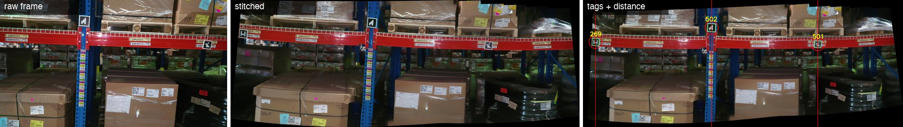

# vertical_distance_mapping_warehouse

Turns a drone flyover video of warehouse racking into stitched panoramas and measures the distance between rack poles from the ArUco tags mounted on them. For mapping rack layouts without walking the aisles with a tape measure.


<!-- docs/pipeline.gif is built from the committed results/set_10 sample. To replace it with a live run: screen-record `python main.py` from src/ with the full pipeline uncommented, then open results/stitched/set_10.jpg and results/stitched_aruco/set_10.jpg. ~15 seconds. -->

## Why I built this

Measuring pole-to-pole distances along warehouse racking by hand is slow and error-prone. The racks already carried ArUco tags of known size on every pole, and a drone could fly an aisle in minutes. So I wrote a pipeline that rebuilds each rack bay from the video and reads the distances off the tags.

## Run it locally

```bash
git clone https://github.com/IgorKlymenko/vertical_distance_mapping_warehouse.git
cd vertical_distance_mapping_warehouse
pip install -r requirements.txt
```

You also need, relative to the repo root:

- `data/raw/sample1.mp4` — the drone video (path is hardcoded in `src/main.py`)
- `weights/yolo/vert-stitch-YOLOv9.pt` — custom YOLO weights for pole and beam detection (not in the repo)
- `weights/configs/data.yaml` — class names for those weights
- `weights/sam/sam_vit_h_4b8939.pth` — downloaded automatically on first run if absent

Then:

```bash
cd src
python main.py
```

As committed, `main.py` only runs the first step (rotate the video to portrait and split it into 20-second segments). The rest of the pipeline is there but commented out. Uncomment the stages you want in order. A GPU helps for the SAM and YOLO steps.

## How it works



```
video ──> detect_poles.py ──> results/set_N/ ──> stitch.py ──> stitched/ ──> segm_rotate.py ──> rotated/
          (YOLO finds poles,     (frames around    (OpenCV          (SAM mask + linear fit
           groups frames so       each pole gap)    Stitcher)        on the beam -> tilt angle)
           each set spans one
           pole-to-pole gap)                                                   |
                                                                               v
                              measure_aruco.py <── stitched_aruco/ <── stitch.mark_aruco
                              (tag size in px vs known size -> px/unit ratio -> distance between tag centres)
```

Key files: `src/detect_poles.py` decides which frames form a panorama, `src/stitch.py` does the stitching and tag marking, `src/measure_aruco.py` converts pixel distances to metric.

## The hard part

Deciding which frames go into which panorama. The first version (June 2024) cut the video into fixed windows of `frame_rate * frames_per_pano` frames and stitched each window. That breaks whenever the drone changes speed: a panorama ends up with one pole, or three, and the distance measurement is meaningless.

The fix in `detect_poles.py` runs a YOLO model on every extracted frame, tracks each pole by the ArUco tag nearest to it, and records the first and last frame where that pole is visible. A panorama is then built from the last three frames of pole N plus the first three of pole N+1, so every stitched image spans exactly one gap and contains both tags it needs.

The tradeoff is a custom-trained YOLO model that has to be maintained, a GPU-sized dependency for a step that used to be arithmetic, and a hard requirement that every pole carry a tag. I took that over the fixed-window approach because the whole point is the measurement, and the measurement is only valid if the panorama boundaries follow the poles.

## Stack

Python, OpenCV (Stitcher, ArUco), Ultralytics YOLO, Segment Anything, PyTorch, scikit-learn, NumPy, matplotlib.

## Status

Last substantive commit August 2024. Works end to end on the sample footage but not finished:

- The full pipeline in `main.py` is commented out; the entry point only preprocesses video.
- `draw_distance` in `detect_poles.py` and the ArUco-anchored stitcher in `measure_aruco.py` are unfinished or superseded dead code.
- Paths, confidence thresholds, and tag sizes are hardcoded constants, not arguments.
- No tests.
