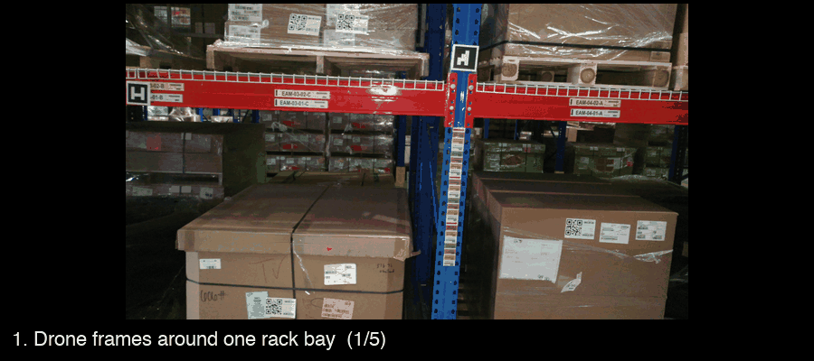
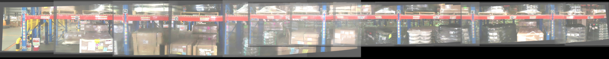

# Stitching drone footage into measured warehouse aisles

Fly a drone down a warehouse aisle, get back a stitched panorama (and metric map) of every rack bay and the distance between each pair of rack poles, read off the ArUco tags mounted on them.


<sub>One aisle, one drone pass, stitched bay by bay. Shown as two rows.</sub>

You don't need to walk the aisle with a tape measure.
Every distance comes from the tags; YOLO and SAM only decide where one bay ends and the next starts.
One command runs all seven stages, and you can stop or restart at any of them.



## why

I was hired as a software engineer, and the first thing they wanted was for me to go out and measure the racking by hand, in the Thai heat. Measuring pole-to-pole distances with a tape is slow and people get it wrong. The racks already carried an ArUco tag of known size on every pole, and a drone flies an aisle in minutes. I think the tags do more of the work than the models do: once you know a tag is 10 cm wide, a pixel distance between two tag centres is a metric distance, and everything else in the pipeline exists to get two tags into one level, well-stitched image.

## run it

```bash
git clone https://github.com/IgorKlymenko/drone-warehouse-mapping.git
cd drone-warehouse-mapping
uv run src/main.py --video path/to/flight.mp4        # uv installs the dependencies itself
# or: pip install -r requirements.txt && python src/main.py --video path/to/flight.mp4
```

Two model files are needed. SAM downloads itself on first use (2.5 GB). The YOLO pole/beam model is custom-trained and not in the repo; open an issue or email me and I'll send it. Put it at `weights/yolo/vert-stitch-YOLOv9.pt` or pass `--yolo-weights`. The script checks for both before it starts and tells you what's missing.

Results land in `output/`: one folder of frames per bay, then `stitched/`, `rotated/`, and finally `distances.csv` with its histogram. Thresholds, tag sizes in metres, the ArUco dictionary and all paths are flags; `--help` lists them. The seven stages can be run as a slice:

```bash
uv run src/main.py --video flight.mp4 --stop-after stitch        # stop before the GPU steps
uv run src/main.py --video flight.mp4 --start-at rotate          # pick up from existing output/
uv run src/main.py --video flight.mp4 --poles-conf 0.5 --tag-size-even 0.12 --no-show
```

A GPU helps for `detect` and `rotate`. Stitching, tag marking and measuring need only OpenCV.

## what each bay goes through

Frames are pulled from the video (every 9th by default). `src/detect_poles.py` runs YOLO on each one, finds the tag nearest each pole box, and groups frames so that each set spans exactly one pole-to-pole gap. OpenCV's Stitcher turns a set into a panorama. Then `src/segm_rotate.py` levels it: YOLO finds the shelf beam, SAM masks it, a line is fitted through the mask, and the image is rotated by that angle. Last, `src/measure_aruco.py` detects the tags, converts pixels to metres from the known tag size (10 cm for even IDs, 8.4 cm for odd), and reports the distance between tag centres. Repeat for every gap and the bays add up to the aisle at the top of this page.

Four bays from one run, tags boxed:


The whole aisle at full resolution, click to zoom:



The last stage prints every gap in metres and plots the spread:


## which frames belong to which panorama

The June 2024 version cut the video into fixed windows of `frame_rate * frames_per_pano` frames and stitched each window. That breaks the moment the drone changes speed: a panorama ends up holding one pole, or three, and the measurement means nothing.

Now `detect_poles.py` runs YOLO on every extracted frame, tracks each pole by the tag nearest it, and records the first and last frame that pole shows up in. A panorama is built from the last three frames of pole N plus the first three of pole N+1, so every stitched image covers exactly one gap and contains both tags it needs.

The price is a custom YOLO model to maintain, a GPU-sized dependency for a step that used to be arithmetic, and a hard requirement that every pole carries a tag. I took that trade because the measurement is only valid if the panorama boundaries follow the poles. I also first tried running SAM's automatic mask generator over whole panoramas; it wanted 11 GB and my laptop GPU gave up, so SAM now only gets the beam box YOLO hands it.

## stack

Python, OpenCV (Stitcher, ArUco), Ultralytics YOLO, Segment Anything, PyTorch, scikit-learn, NumPy, matplotlib.

## status

Works end to end on the sample footage. Because the YOLO weights are on request rather than in the repo, a fresh clone runs the OpenCV stages out of the box and the full pipeline once you have them.

## license

No license file yet.
